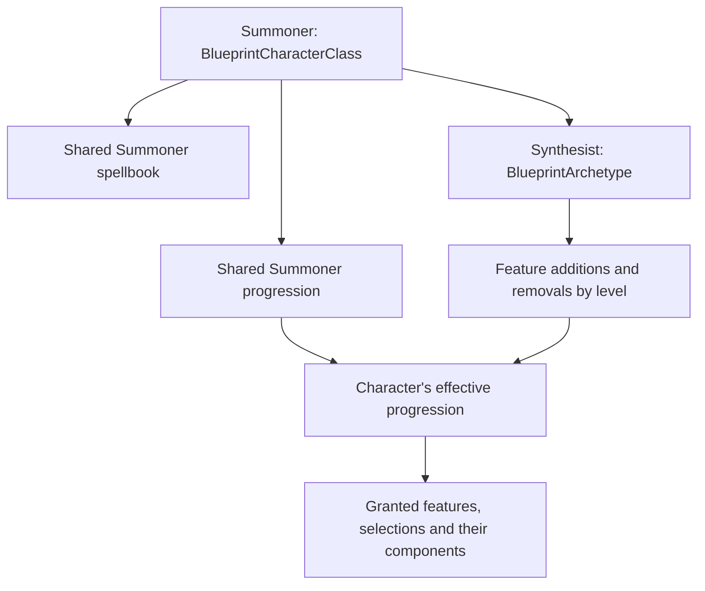

# How Wrath of the Righteous handles archetypes

Research date: **31 October 2026**. Branch: `synthesist`. Gameplay source checkpoint: `d796726`.

The game already has a native archetype system. A Synthesist can be a real archetype of Making Friends' Summoner: retain the class and its normal progression, then declare which feature grants to replace. Fusion itself still needs abilities, buffs and suitable components; registering an archetype does not create transformation behaviour.

This is research, not an approved implementation plan. No archetype, gameplay component, blueprint identifier or game file was changed for this investigation.

## Evidence and scope

I inspected the installed WotR 2.7.0x `Wrath_Data/Managed/Assembly-CSharp.dll`, the game's `blueprints.zip`, our current Summoner code, the supplied development brief, BlueprintCore **v2.8.4** source/documentation and one public archetype implementation. The game assembly SHA-256 was `2CB7160B7154D4FFACC77B9C51B1EB26199E1294300F04FDFC073367B2EF8953`.

Seven native archetypes were examined. A temporary index resolved 12,060 class-folder blueprint identifiers to their source paths. For each example, its parent class listed the archetype and every removal reference matched a feature occurrence at the stated level in the parent progression. That is a static consistency check, not seven in-game tests.

Native metadata/IL and blueprint summaries are retained only under the ignored local `artifacts/archetype-research` directory. This report does not redistribute the game's assemblies or complete blueprint files. Python's ZIP reader could read the game's ZIP64 archive; Windows PowerShell's older .NET ZIP reader misreported entry lengths and failed to open the selected entries.

## 1. The relationship between class and archetype

The main native types have distinct roles:

| Native type | Role |
|---|---|
| `BlueprintCharacterClass` | Defines the class, default statistics, spellbook, progression and available archetypes. Its `m_Archetypes` array is the registration point. |
| `BlueprintArchetype` | Defines the archetype's name, description, level-by-level changes, prerequisites and optional class overrides. |
| `BlueprintProgression` | Defines feature grants at class levels. It can itself grant another progression or a feature selection. |
| `LevelEntry` | Associates a level with a list of feature references. Repeated occurrences and the exact blueprint references matter. |
| `ClassData` | Stores the character's levels in that class, selected archetypes and effective spellbook. |
| `ProgressionData` | Calculates the character's effective level entries after archetype changes. |

The installed `BlueprintArchetype.GetParentClass()` finds its owner through the available classes' archetype lists and caches it. The lookup expects a unique parent. One archetype blueprint should therefore be registered with one class; reusing the same archetype blueprint on multiple classes is unsafe.

An archetype is not a second class to level separately. Levels, BAB and spellcasting continue through the parent class, with any declared overrides applied.

## 2. How the game applies the changes

The inspected path is:

1. The native `AddArchetype.Check()` confirms the archetype belongs to the selected class and asks `UnitProgressionData.CanAddArchetype()` whether it can be applied.
2. `AddArchetype.Apply()` records it through `UnitProgressionData.AddArchetype()` and applies prerequisite restrictions.
3. The archetype is added to both `ClassData` and the class's `ProgressionData`. The latter recalculates its level entries.
4. `ProgressionData.CalculateLevelEntries()` copies each base level's feature list, removes the declared occurrences at that level and adds the archetype's replacement grants. It also adds archetype grants at levels absent from the original progression and sorts the resulting entries.
5. Normal level-up processing grants the resulting features and selections. Their components supply the actual behaviour.

Conceptually, for a particular level:

`effective grants = base grants − matching removed occurrences + archetype grants`

This is a feature-list operation, not an automatic rewrite of every ability associated with the class. It is also not a command to search the whole character and delete anything with a similar name.

Important consequences:

- **Removal is by blueprint identity and level.** A replacement with the same displayed name is still a different blueprint. Removing a level-one grant does not automatically suppress later grants of that feature.
- **Nested progressions and selections need tracing.** A root feature may grant a progression, selection or component that creates further facts. The class's replacement list does not automatically traverse and rewrite that subtree.
- **New levels are allowed.** An archetype can grant something at level 16 even if the base progression has no level-16 entry.
- **The base progression need not be edited globally.** Changes to the effective progression can apply to the archetype character while ordinary Summoners keep their normal grants.

### Eligibility and combinations

`BlueprintArchetype.MeetsPrerequisites()` evaluates prerequisite components. Separately, the progression guard compares class level with the earliest affected level, obtained from `MinFeatureLevel`; spellbook replacement/removal makes that minimum level one. Archetype selection should not be treated as an unrestricted conversion of a developed character.

The native compatibility check also rejects conflicting spellbook changes and checks that the effective progression still contains enough occurrences of each requested removal. There is machinery for multiple selected archetypes, but that does not establish that the unmodified UI exposes arbitrary combinations. Any ToyBox-enabled combinations would require their own testing.

An entirely empty selectable archetype is a poor initial scaffold: in the inspected implementation, `MinFeatureLevel` takes the minimum of its added/removed levels unless a spellbook change supplies level one. With both arrays empty, that calculation has no minimum. A first implementation increment must provide valid progression data.

## 3. What an archetype can override directly

These fields exist on the installed `BlueprintArchetype`:

| Area | Native fields | Interpretation |
|---|---|---|
| Feature progression | `AddFeatures`, `RemoveFeatures` | Explicit grants and removals by level. |
| Main spellbook | `m_ReplaceSpellbook`, `RemoveSpellbook` | Replace or remove the class spellbook. With neither set, it remains inherited. |
| BAB and saves | `m_BaseAttackBonus`, `m_FortitudeSave`, `m_ReflexSave`, `m_WillSave` | Optional progression overrides; unset references fall back to the class. |
| Skills | `ReplaceClassSkills`, `ClassSkills`, `AddSkillPoints` | Replace the class-skill list and/or adjust its stored skill-point value. |
| Caster classification | `ChangeCasterType`, `IsArcaneCaster`, `IsDivineCaster` | Changes caster classification. This is distinct from the spellbook's casting ability. |
| Starting equipment | `ReplaceStartingEquipment`, `StartingGold`, `m_StartingItems` | Archetype-specific starting equipment configuration. |
| Recommendations and presentation | Localised name/descriptions, icon, recommended attributes, signature abilities, difficulty and visibility | UI and character-building information, not substitutes for mechanical feature components. |

There is no direct hit-die override among the inspected archetype fields. Similarly, changing a recommended attribute does not change the spellbook's casting attribute.

These are class-wide archetype settings. In particular, assigning an archetype BAB progression is **not** a solution for replacing BAB only while fused: that would affect the archetype's class progression outside fusion too. Temporary fusion effects belong in the fusion mechanics layer.

## 4. Native examples inspected

Paths below are inside the installed `blueprints.zip`.

| Example | Verified behaviour in its data | What it teaches us |
|---|---|---|
| Vivisectionist | Removes `AlchemistBombsFeature` at levels 1, 3, 5 ... 19; grants `SneakAttack` at those levels. Replaces recurring discovery selections separately. | A feature family must be replaced across all affected levels, not just its first grant. |
| Elemental Rampager | Removes `DruidBondSelection` at level 1, plus later defensive features; adds claws, rampage and associated selections. | A companion-granting selection can be traded for a different feature family without making another Druid class. |
| Feyspeaker | Replaces the spellbook and class skills, changes BAB, adjusts skill points and moves Wild Shape grants to later levels. Its replacement spellbook specifies Charisma. | Timing changes are explicit removal/addition pairs. Casting-stat changes are in the spellbook. |
| Sacred Huntsmaster | Removes Judgment and its later upgrades, plus Solo Tactics; adds a companion selection, companion tactics and Favoured Enemy grants. | Companion archetypes combine ordinary replacement lists with separately implemented companion mechanics. |
| Eldritch Scion | Replaces the Magus spellbook and several feature/selection families; moves Improved/Greater Spell Combat from 8/14 to 14/18. | A substantial archetype still uses the original class, with explicit spellbook and feature changes. |
| Scaled Fist | Replaces AC, ki, feat and power features/selections with distinct Scaled Fist blueprints. | Changed mechanics live in replacement features; the archetype record arranges when they are granted. |
| Sylvan Sorcerer | Removes `SorcererBloodlineSelection` at level 1; grants `SylvanBloodlineProgression` and its companion selection. | A root-level archetype grant can introduce an entire nested progression. |

Exact archetype records:

| Blueprint path | AssetId |
|---|---|
| `Classes/Alchemist/Archetypes/Vivisectionist/VivisectionistArchetype.jbp` | `68cbcd9fbf1fb1d489562f829bb97e38` |
| `Classes/Druid/Archetypes/ElementalRampager/ElementalRampagerArchetype.jbp` | `f815594bd1e3454182022d375bf70fd1` |
| `Classes/Druid/Archetypes/Feyspeaker/FeyspeakerArchetype.jbp` | `da69747aa3dd0044ebff5f3d701cdde3` |
| `Classes/Inquisitor/Archetypes/SacredHuntsmaster/SacredHuntsmasterArchetype.jbp` | `46eb929c8b6d7164188eb4d9bcd0a012` |
| `Classes/Magus/Archetypes/EldritchScion/EldritchScionArchetype.jbp` | `d078b2ef073f2814c9e338a789d97b73` |
| `Classes/Monk/Archetypes/ScaledFist/ScaledFistArchetype.jbp` | `5868fc82eb11a4244926363983897279` |
| `Classes/Sorcerer/Archetypes/SylvanSorcererArchetype.jbp` | `711d5024ecc75f346b9cda609c3a1f83` |

## 5. How our existing library supports it

The project pins BlueprintCore **2.8.4**, so I checked that tag rather than assuming the current documentation describes our exact version.

Its [`ArchetypeConfigurator`](https://github.com/WittleWolfie/WW-Blueprint-Core/blob/v2.8.4/BlueprintCore/BlueprintCore/Blueprints/CustomConfigurators/Classes/ArchetypeConfigurator.cs) supports:

- Creating an archetype with a supplied parent class, or associating it with `SetClass()`.
- Adding/removing feature entries by level, including `LevelEntryBuilder` support.
- Appending the configured archetype to the parent's archetype list when configuration completes.

There is no need to add another character-class entry to `BlueprintRoot` for Synthesist. Our existing Summoner class must be registered first, and the archetype's referenced features must exist when its configuration is resolved.

The public [Arrowsong Minstrel implementation](https://github.com/WittleWolfie/CharacterOptionsPlus/blob/main/CharacterOptionsPlus/CharacterOptionsPlus/Archetypes/ArrowsongMinstrel.cs) uses this pattern for Bard: configure an archetype on the parent class, list explicit level-based removals/additions, and attach the features' separate mechanics. It also highlights the danger of similarly named selection references. Its use of the API is a reference pattern, not evidence that that whole mod is compatible with our current game.

Feature visibility and progression grouping should be checked separately from whether effects are granted. The game has archetype-aware character-creation and progression views; `BlueprintProgression.UIGroups` and `m_UIDeterminatorsGroup` also carry display information. A selectable archetype with working effects can still have an unclear progression display.

## 6. Findings specific to Making Friends

The registration point is [SummonerClass.cs](../CharacterClass/SummonerClass.cs). It already creates the Summoner class, assigns its progression and primary spellbook, and registers it with the game. It currently attaches no archetypes.

The current top-level grants in [SummonerProgression.cs](../CharacterClass/SummonerProgression.cs) give us concrete replacement targets:

| Level | Relevant existing grant | Relationship to the supplied brief |
|---|---|---|
| 1 | `SummonerLifeLinkFeature` | The brief names Fused Link as its replacement. |
| 1 | `EidolonBaseFeatureSelection` | Begins body/model selection and ultimately companion creation. This is not just a descriptive marker. |
| 1 | `EidolonProgression`, `EidolonRankFeature` | Drive shared eidolon advancement; removing these blindly could discard the progression we intend to reuse. |
| 2 | `SummonerBondedSensesFeature` | Named among the features replaced by Fused Eidolon. Its removal entry would be level 2 even though the new feature begins at level 1. |
| 4 | `SummonerShieldAllyFeature` | Corresponds to Shielded Meld's replacement target. |
| 6 | `SummonerMakersCallFeature` | Corresponds to Maker's Jump's replacement target. |
| 8 | `SummonerTranspositionFeature` | The brief also replaces this with Maker's Jump; it needs its own level-8 removal. |
| 12 | `SummonerShieldAllyGreaterFeature` | Corresponds to Greater Shielded Meld's replacement target. |
| 14 | `SummonerLifeBondFeature` | Another later removal named by the brief's Fused Eidolon replacement. |
| 16 | No top-level grant | The brief says Split Forms replaces Merge Forms, but no Merge Forms grant was found in this mod's current class progression. We must resolve that difference rather than invent a removal reference. |

This table compares existing code with the supplied brief. It does not approve a final replacement table or settle the fusion architecture.

### Selection, progression and spawning are coupled

In [FeatureEidolonSelection.cs](../Features/EidolonFeatures/BaseFeatures/FeatureEidolonSelection.cs), the selection chain ends in model-specific companion features with `AddEidolon` components. Those components actually spawn/link the pet. The hidden [EidolonProgression](../Progressions/ProgressionEidolon.cs) grants further `EidolonRankFeature` ranks from levels 2–20.

We need to preserve the useful choice/progression/evolution data while defining the Synthesist's active-creature behaviour. Simply retaining the normal companion feature can leave a separately active eidolon; simply removing the whole chain can remove data fusion needs. The archetype system provides the replacement hook, but it does not decide how that retained eidolon state should work.

Likewise, replacing a root progression grant is different from removing individual grants inside that nested progression. The native eligibility check expects removal references to exist in the effective class progression at the specified level. A nested grant should not be inserted into a top-level removal list without tracing where it is actually granted.

### Preserve shared class behaviour deliberately

The primary Summoner spellbook can remain inherited unless the design requires a change. However, [SummonerSecondSpellbook.cs](../CharacterClass/SummonerSecondSpellbook.cs) also adds a book through `SummonerSecondSpellbookFeat` and an `AddSpellbook` component. The archetype's main-spellbook flags do not automatically rewrite that feature-added system.

Existing evolution/resource helpers frequently operate on the linked eidolon and its custom pet type. Choosing Synthesist does not automatically retarget those helpers to the Summoner. That integration needs explicit inspection alongside the fusion controller.

Any shared blueprint modifications must preserve ordinary Summoners. Archetype-specific replacement features or appropriately scoped conditions are preferable to globally removing components from features used by the base class. Stable blueprint GUIDs are needed for new archetype/features/abilities/buffs; a custom C# component's serialisation TypeId is a separate identifier.

## 7. Persistence and remaining questions

The native `ClassData` and `ProgressionData` expose JSON-serialised archetype collections through their converter properties. The engine therefore already has a persistence path for the archetype selection. This does **not** establish save/load correctness for custom fusion state, retained pet references, temporary modifiers or respec cleanup.

Before implementation, the remaining investigations are narrower than “how do we make an archetype?”:

1. Finalise the feature replacement table against this mod's actual grants, including the absent Merge Forms feature.
2. Decide how body/evolution progression remains available without an independently active eidolon while fused, and how Split Forms will use it.
3. Inspect transformation components and physical-score/BAB handling for the hybrid fusion system described in the brief.
4. Trace the existing summon/evolution restrictions that depend on pet presence and establish how fusion should satisfy them.
5. Verify a real archetype through creation, level-up, multiclassing, saving/loading and respec, while checking an ordinary Summoner remains unchanged.

The previous portrait/inventory symptom remains a separate baseline verification matter unless further evidence connects it to these systems. This research neither diagnoses nor fixes that symptom.

## Sources

- Installed WotR 2.7.0x files: `Assembly-CSharp.dll` and `blueprints.zip`; native type/method names and exact blueprint paths are identified above.
- BlueprintCore pinned [archetype configurator source](https://github.com/WittleWolfie/WW-Blueprint-Core/blob/v2.8.4/BlueprintCore/BlueprintCore/Blueprints/CustomConfigurators/Classes/ArchetypeConfigurator.cs), plus the locally installed package's `BlueprintCore.xml` API documentation.
- [BlueprintCore overview](https://wittlewolfie.github.io/WW-Blueprint-Core/): configurators, actions, components and validation. Validation is not a gameplay test.
- [Character Options+ Arrowsong Minstrel](https://github.com/WittleWolfie/CharacterOptionsPlus/blob/main/CharacterOptionsPlus/CharacterOptionsPlus/Archetypes/ArrowsongMinstrel.cs): a concrete archetype registration/replacement example.
- [Existing modding research](WOTR_MODDING_RESEARCH.md): official template and community documentation context. Documentation for Kingmaker or Rogue Trader must not be assumed to describe Wrath's archetype types.
- Supplied Synthesist development brief and the current Making Friends fork, used for the project-specific comparison.
